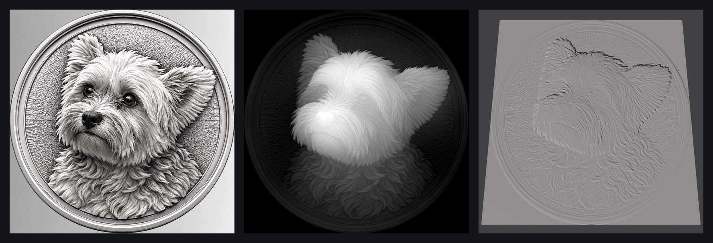
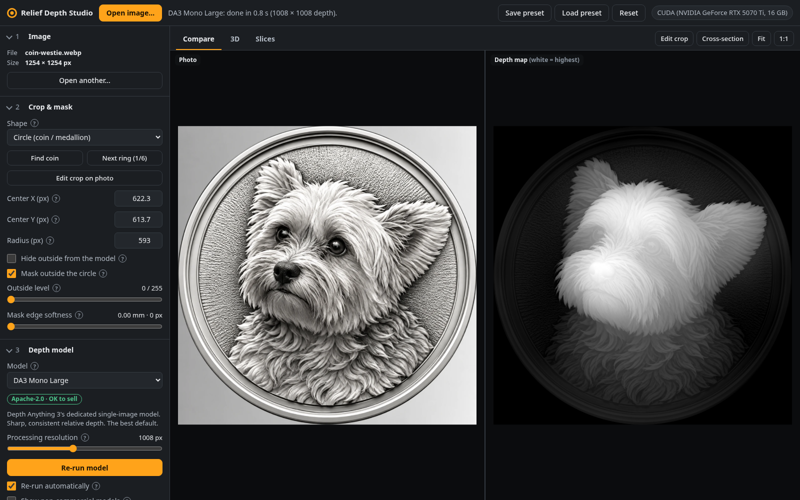
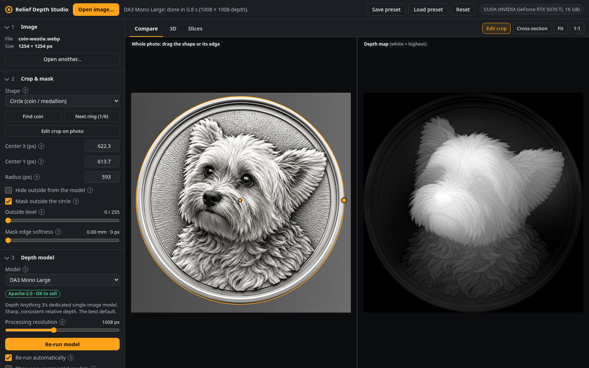
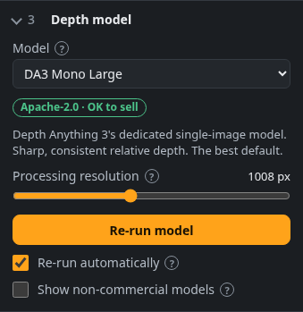
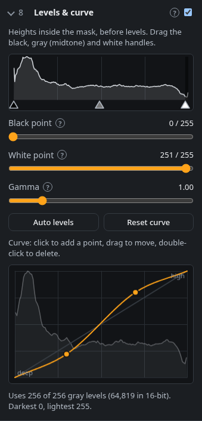
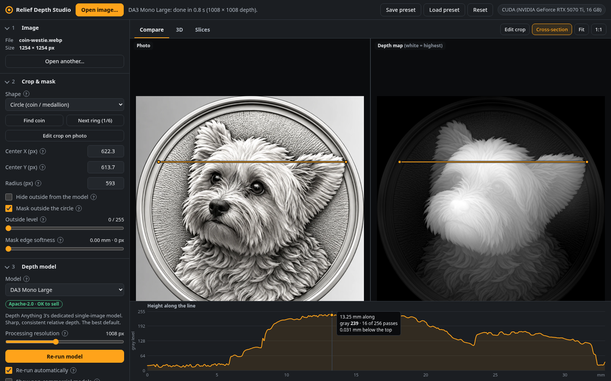
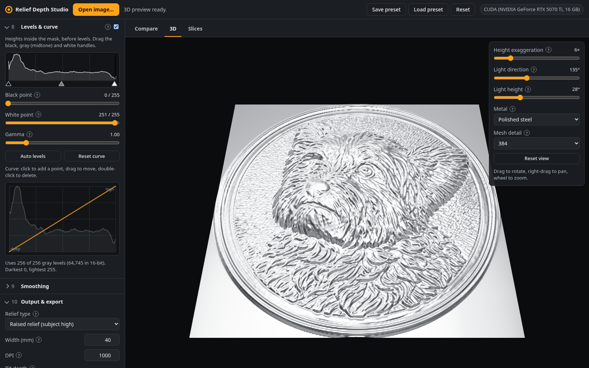
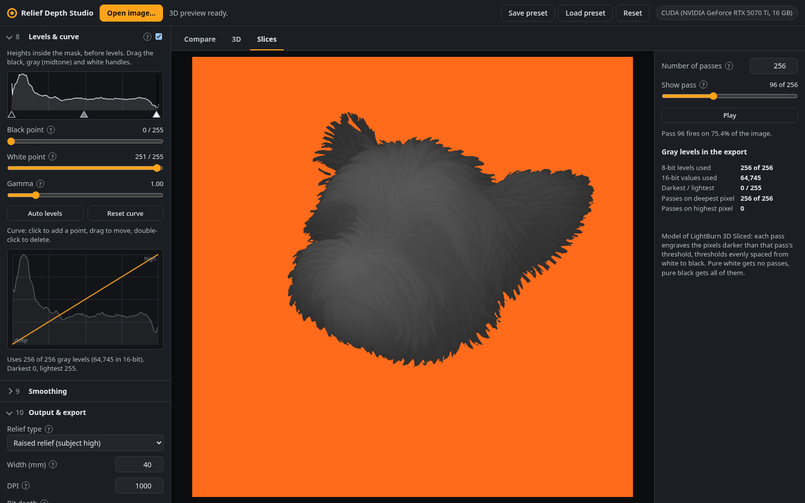
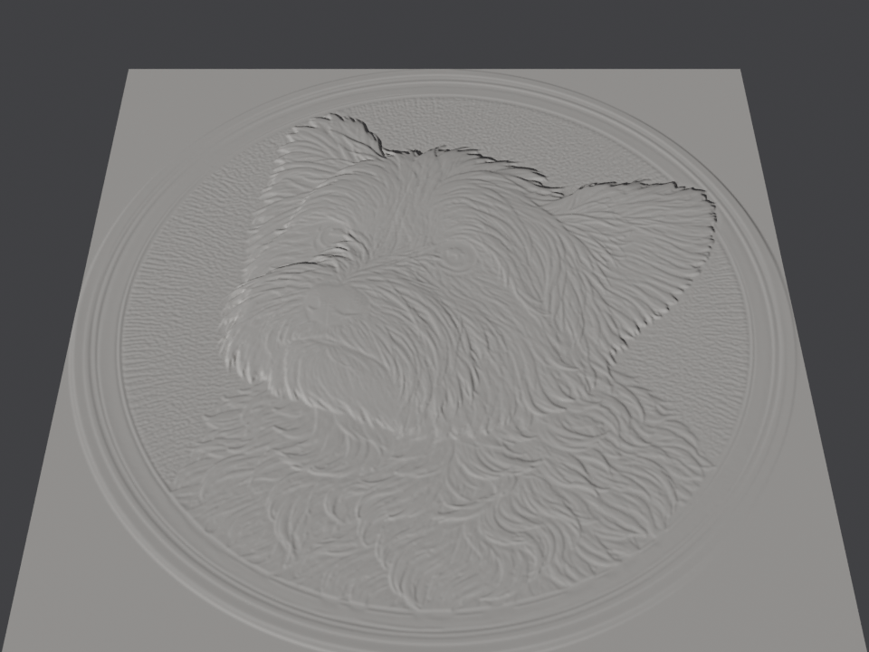

# Relief Depth Studio

**Turn a picture of a coin, medallion or relief into a smooth grayscale depth map for 3D deep
relief engraving on a fiber galvo laser.** Made for LightBurn's *3D Sliced* image mode; the PNG
also works in EzCad3. Runs locally on your own computer, with your GPU.

[](https://github.com/palamedes/coin-depth-mapper/actions/workflows/tests.yml)
[](LICENSE)


<sub>Left: the input image. Middle: the exported 16-bit depth map (white = highest). Right: that map displaced in Blender at real size.</sub>

## What it does

- **AI depth estimation** with your choice of model: Depth Anything 3 (default), Marigold, MonoRelief V2, or a
  lightweight model that runs right in the browser. Each model's license is shown, so you know
  which are fine for pieces you sell.
- **Finds the coin for you**: detects the circular outline (and the inner rings), masks everything outside it.
- **Puts a cut-out on a coin**: open a picture with a transparent background (a pet portrait, a logo) and it
  lands on a blank coin from your coin library. Drag and resize it freely; add your own blank coins.
  The coin and the subject each have their own levels and curve.
- **Text layers**: lettering around the top or bottom of the coin, or straight anywhere, in any font;
  raised or sunk, with sloped edges, an outline, and a background plate with a border.
- **Engraving-ready output**: the full 0-255 range on purpose, smooth and continuous (never dithered),
  no stray pits. 16-bit or 8-bit PNG with the DPI written in, so it imports at the exact width you set.
- **Live preview of every adjustment**: tilt removal, edge-aware upsampling, fur/hair detail boost,
  background flattening, a raised rim, levels and curves, despeckle and smoothing.
- **See it before you burn it**: synced side-by-side view, a 3D metal preview, a LightBurn
  pass-by-pass slice preview, and a cross-section height graph.
- **Projects**: save a piece (images, every setting, text and depth maps) and reopen it later exactly
  as it was, with no waiting for the model.
- **Exports** 16/8-bit PNG and STL; saves presets; includes a Blender helper script.

No laser power, speed or frequency suggestions anywhere: you dial those in for your machine.

## Quick start

1. Install **[uv](https://docs.astral.sh/uv/getting-started/installation/)** (a small Python manager; it fetches
   the right Python and libraries for you).
   - Linux / macOS: `curl -LsSf https://astral.sh/uv/install.sh | sh`
   - Windows (PowerShell): `powershell -ExecutionPolicy ByPass -c "irm https://astral.sh/uv/install.ps1 | iex"`
2. Download this repository (green **Code** button → *Download ZIP*, or `git clone https://github.com/palamedes/coin-depth-mapper.git`).
3. Start it:
   - Linux / macOS: `./depthmap` in the folder
   - Windows: double-click **`run.bat`**

Your browser opens at `http://127.0.0.1:8790`. The first start takes a few minutes: it installs
Python 3.12 and PyTorch (about 3 GB). The first time you generate depth with a model, its weights
download too (DA3 Mono Large 1.3 GB, Marigold 2.6 GB), with progress in the status bar. After
that it starts in seconds and works offline.

```bash
./depthmap --help          # --port 9000, --no-browser, --host 0.0.0.0 (let other devices on your network in)
ln -s "$PWD/depthmap" ~/.local/bin/depthmap    # optional: run `depthmap` from anywhere
```

Node.js is **not** needed: a built copy of the web interface is included.

### What computer do I need?

| Hardware | Result |
|---|---|
| NVIDIA GPU (GTX 16xx / RTX 20xx through RTX 50xx) with driver **580 or newer** | Fast: DA3 takes under a second per image on an RTX 5070 Ti. |
| Apple Silicon Mac | Uses the Apple GPU (MPS) automatically. |
| No GPU | Works on the CPU with a warning. DA3 at the default resolution took 18 s on a 32-core desktop CPU (3 s at 504 px); expect a minute or more on a small PC. Marigold is much slower. Lower the processing resolution to speed it up, or use the in-browser model. |

About 8 GB of disk for PyTorch plus the models you use. Developed and tested on Linux with an
RTX 5070 Ti; Windows and macOS should work the same way (please open an issue if they don't).

## How to use it



### 1. Open the image and check the crop

Drop a PNG, JPG or WebP on the window (or *Open image…*, or paste with Ctrl+V). Coin and medallion
renders work best. The circle is found automatically; **Next ring** cycles through the other rings
it found (rim, inner field). To adjust by hand, click **Edit crop**: drag inside the circle to
move it, drag its edge to resize. Switch *Shape* to *Rectangle* for plaques and tiles.



#### Putting a cut-out on a coin

Open a PNG or WebP with a **transparent background** (`samples/toby.webp` is one) and the app treats
it as the *subject*: it goes on the first coin in the **Coin** section, and *Generate depth* runs the
model twice, once on the coin and once on the subject. Then:

- **Pick a coin** by clicking it in the *Coin* section. The library is every PNG, JPG or WebP image of a
  blank coin in the `coins/` folder (`standard` comes first). **Add coin…** copies an image there;
  files you copy in by hand show up after a page reload. Set `RDS_COINS_DIR` to keep them elsewhere.
- **Place the subject** with **Place subject** (above the images): drag it to move it, drag a corner
  of its box to resize it. Or use the *Size*, *Left / right* and *Up / down* sliders. The subject has
  its own depth, so moving it never re-runs the model.
- **Set the heights**: *Field height* is the coin's flat background, *Coin top* its highest part
  (usually the rim), and the subject's *Height* is its highest point. The subject always stands on
  the coin's surface. Depth models read a blank coin's flat field as tilted or domed, so with
  *Remove tilt* on, the rim and pattern are measured from the coin's own base and the field comes out flat.
- **Shape each layer on its own**: the *Levels & curve* step has a tab for each layer. **Master** is
  the final pass over everything; **Coin** and **Subject** each have their own levels and curve, with
  a histogram of just that layer, applied before they're combined. Each one has a **Strength** slider
  (0–120%) that keeps the shape you set but makes the relief gentler or stronger: a layer's relief
  stands lower or taller on what's under it, and Master makes the whole map shallower or deeper below
  the top surface. Untick the step to compare with none of them.
- Opening a regular image while a subject is on the coin makes that image the coin; **Remove** in
  the *Subject* section takes the subject off. Exports are named after both, e.g. `toby_on_standard_…png`.

#### Adding text

In the **Text** section, **Add text** adds a line of lettering (the subject's name, to start with);
add as many as you like. Each one has:

- **Text, font, bold, italic, letter size** (the height of the capitals, in mm) and **letter spacing**.
  Fonts in the `fonts/` folder come first (Cinzel, a classic Roman coin face, is included), then the
  fonts installed on your computer; **All installed fonts** lists every one (Chrome and Edge ask
  first), and **Add font file…** copies a TTF, OTF or WOFF into the folder. If you sell pieces, check
  the font's license allows it. Cinzel's (SIL Open Font License) does.
- **Layout**: *Arc along the top* (reading clockwise), *Arc along the bottom* (upright, reading left
  to right), each with a radius and a position around the coin; or *Straight*, with a position and rotation.
- **Height and edge slope**: letters rise to their height, or are cut in when it's below the surface
  around them. The **letter profile** curve shapes their sloped sides (rounded, pointed, stepped).
- **Outline**: a line around the letters, with its own width, gap and height.
- **Background**: a plate behind the text (a box or pill for straight text, a band that follows the
  arc for curved text), raised or recessed, with an optional border.

### 2. Generate depth



Pick a model and press **Generate depth** (it runs by itself once the model is downloaded). The
badge shows each model's license: green means fine to sell, amber means allowed with use
restrictions, and non-commercial models are hidden unless you ask for them.

*Processing resolution* is the size the model works at: higher keeps finer detail and uses more GPU
memory. With *Re-run automatically* on, changing the crop or model settings re-runs it.

<br clear="right">

### 3. Shape the relief

The left panel follows the processing order. Every control has a **?** with a plain-language explanation.

| Step | What it's for |
|---|---|
| **Level & upsample** | *Remove tilt* takes out the "coin leaning back" slope depth models tend to add. Guided upsampling enlarges the depth to the output size using the photo, so edges stay crisp. |
| **Detail boost** | Brings back fine texture (fur, hair, engraving lines) that depth models smooth away. It's soft-clipped so highlights can't turn into spikes or pits. |
| **Background flatten** | Makes the coin's field one perfectly flat level. |
| **Rim** | Adds a raised ring around the edge (a frame for rectangles). |
| **Levels & curve** | Black point, white point, a draggable midtone (gamma), a tone curve, live histogram, a strength for the whole effect, and *Auto levels* to use the full range. For everything together (*Master*), and for the coin and the subject on their own. |
| **Smoothing** | Despeckle removes isolated pits; edge-preserving smoothing and a final blur remove noise and banding. |
| **Output** | Raised relief or sunk (intaglio), width in mm, DPI, 16 or 8-bit. |



Sizes (detail size, rim width, blur…) are in **millimetres on the finished piece**, so a preset
looks the same at any DPI. Adjustments preview instantly on a downscaled copy; the export redoes
everything at full resolution.

**Save preset** / **Load preset** store all settings except the crop position; your last
settings are remembered automatically.

<br clear="right">

### 4. Check it before you burn

**Cross-section**: draw a line across either image to graph the height along it. Hover the graph
for the gray level, how many passes LightBurn will fire there, and the depth in mm.



**3D**: the map as a lit metal surface. Rotate it, exaggerate the height, and move the light low
to rake across the surface and reveal small bumps and pits. It uses the graphics card (WebGL) when the
browser allows it; otherwise the CPU draws the same picture, just less smoothly.



**Slices**: exactly which pixels fire on pass *k* of *N* in LightBurn's 3D Sliced mode (orange), how
many gray levels your map uses, and warnings if the darkest pixel isn't black (some depth goes
unused) or the lightest isn't white (the whole surface gets engraved).



### 5. Export

Set the width in mm and the DPI, then **Export PNG**. The file name records the settings, e.g.
`coin_40mm_1000dpi_16bit.png`. **Export STL** (in *3D preview & STL*) saves a watertight model in
millimetres for a slicer, CNC software or Blender.

### Saving projects

**Save project** (or Ctrl+S) keeps everything about a piece in one file: the coin and subject images
as you opened them, every setting (crop, placement, text, levels), the fonts from `fonts/` that the
text uses, and the depth maps the model made. Reopening it gives exactly the same depth map, without
running the model again, so you can come back to a piece, repeat it at another size, or try changes.

- The first save asks for a name; after that Ctrl+S saves over it (the button shows a dot when there
  are unsaved changes). Ctrl+Shift+S, or a new name in **Projects**, saves a copy.
- **Projects** lists your saved projects with a preview; the start screen shows the recent ones. Hover a
  project to download or delete it.
- Projects live in the `projects/` folder as `.rdsproj` files (about 4 MB each; set `RDS_PROJECTS_DIR`
  to keep them elsewhere). The folder is left out of git, because projects hold your own images.
- A `.rdsproj` file opens from **Open image…** or by dragging it onto the window, so you can move a
  project to another computer. Without the Python backend, saving downloads the file instead.
- A presets file (**Save preset**) is different: it keeps only the settings, to reuse on other images.

## Using the depth map

### LightBurn (3D Sliced)

1. Import the PNG. LightBurn reads the DPI stored in the file, so it comes in at your width.
2. In the layer's Cut Settings set **Image Mode → 3D Sliced**. Leave **Negative Image** off: white is
   already the top surface.
3. **Number of Passes**: 256 gives one pass per gray level of an 8-bit map. LightBurn 2.1+ reads
   16-bit maps in 3D Sliced, so more passes can use the extra smoothness.
4. Match the layer's DPI / line interval to the DPI you exported at, so LightBurn doesn't resample.

How the slice preview models LightBurn: each pass engraves the pixels darker than that pass's
threshold, with thresholds evenly spaced from white to black. A pixel with gray level *v* gets
`N − ceil(v/255 × N)` passes: white none, black all *N*. This follows LightBurn's documentation and
statements from LightBurn staff. The exact rounding at the very lightest and darkest levels isn't
documented and may differ by one pass.

### EzCad3

Import the PNG as a grayscale bitmap for its layered 3D engraving. If your EzCad3 version doesn't
accept 16-bit PNGs, export **8-bit**. If it treats black as the top surface, choose
*Relief type: Sunk* (or use EzCad's own invert) so the convention matches.

### Checking the shape in Blender



Blender shows the 3D shape the map describes (it doesn't simulate laser passes; the Slices tab
does that). The included script builds a plane at real size in millimetres, displaces it with
the 16-bit map, and adds a raking light and a camera:

```bash
blender --python tools/blender_relief.py -- coin_40mm_1000dpi_16bit.png --depth-mm 0.5
```

Options after `--`: `--width-mm` (default: from the PNG's DPI), `--base-mm 2` (solid base),
`--material clay|steel`, `--grid 600`, `--tilt 36`, `--save out.blend`,
`--render out.png --render-size 960x720`. Without the Blender app: `pip install bpy` (Python 3.13)
and `python tools/blender_relief.py file.png --render out.png`.

<br clear="right">

## Models and licenses

If you sell engraved pieces, the model's license matters. Non-commercial models are hidden unless
you tick *Show non-commercial models*.

| Model | Hugging Face weights | License | Good for |
|---|---|---|---|
| **DA3 Mono Large** (default) | [`depth-anything/DA3MONO-LARGE`](https://huggingface.co/depth-anything/DA3MONO-LARGE) | Apache-2.0 ✅ | Sharp, consistent shape. Best all-rounder. |
| DA3 Base | [`depth-anything/DA3-BASE`](https://huggingface.co/depth-anything/DA3-BASE) | Apache-2.0 ✅ | Smaller GPUs; keeps fine texture, flatter overall shape. |
| Marigold Depth v1.1 | [`prs-eth/marigold-depth-v1-1`](https://huggingface.co/prs-eth/marigold-depth-v1-1) | OpenRAIL++-M ⚠️ | Very fine detail. Steps, ensemble size and seed adjustable. Commercial use allowed with use-based restrictions. |
| MonoRelief V2 | not public (see below) | code Apache-2.0 | Trained specifically on reliefs. |
| DA-V2 Small (in browser) | [`onnx-community/depth-anything-v2-small`](https://huggingface.co/onnx-community/depth-anything-v2-small) | Apache-2.0 ✅ | No Python install; quick looks. |
| DA3 Large 1.1 | [`depth-anything/DA3-LARGE-1.1`](https://huggingface.co/depth-anything/DA3-LARGE-1.1) | CC BY-NC 4.0 ❌ | Hidden by default. **Not for pieces you sell.** |

Tip: try Marigold with an ensemble of 3-5 on coin renders. It often keeps finer detail than DA3
and reads a sunken field and raised rim correctly.

**MonoRelief V2.** The [code](https://github.com/glp1001/MonoreliefV2) is public, but as of October
2026 the trained weights are not (the authors offer a newer V3 on request). The app's adapter
is ready for them: if you obtain the weights, place them like this and restart.

```
models/monorelief_v2/Moreliefv2.pth                    (any *.pth name)
models/monorelief_v2/lora/adapter_config.json
models/monorelief_v2/lora/adapter_model.safetensors    (or .bin)
```

Check the license that comes with those weights before selling pieces made with them.

## Lite mode (no Python)

The *DA-V2 Small (in browser)* model runs inside the web page itself, on the GPU through WebGPU
where available, otherwise on the CPU. To use the app on a computer without the Python setup,
serve the built page with any static web server and open it:

```bash
python3 -m http.server 8000 --directory src/relief_depth_studio/web     # then open http://127.0.0.1:8000
```

The app notices there's no backend and offers only the in-browser model. Automatic coin detection
needs the backend, so place the circle with *Edit crop*. The model (~100 MB) downloads on first use.

## Troubleshooting

| Problem | Fix |
|---|---|
| "The GPU ran out of memory" | Lower *Processing resolution* (or Marigold's ensemble size), or close other programs using the GPU. The app frees its other models and retries once by itself. |
| Very slow, badge says **CPU** | No usable GPU was found. On NVIDIA, update the driver to 580+. Older drivers: see below. |
| Older NVIDIA driver (< 580) | In `pyproject.toml` change both `cu130` mentions to `cu126`, then run `./depthmap` again. (cu126 doesn't support RTX 50xx cards.) |
| 3D view says *Drawn in software* and feels sluggish | Your browser has no WebGL, usually because graphics acceleration is off, so the CPU draws the 3D view. It works, just more slowly. For a smoother view: Chrome/Edge: Settings → System → turn on *Use graphics acceleration when available* and relaunch. Firefox: Settings → General → Performance. |
| "Port 8790 is already in use" | It's probably already running; the browser tab opens. Or use `./depthmap --port 9000`. |
| Model downloads are slow or rate-limited | Set a free Hugging Face token: `HF_TOKEN=hf_... ./depthmap`. |
| Force the CPU or a specific GPU type | `RDS_DEVICE=cpu ./depthmap` (or `cuda`, `mps`). |
| Moved the folder and it won't start | `./depthmap` rebuilds its environment automatically; on Windows delete the `.venv` folder. |

## For developers

```
depthmap, run.sh, run.bat      launchers (uv run)
pyproject.toml, uv.lock        Python deps; PyTorch comes from the CUDA 13.0 index
src/relief_depth_studio/
  server.py                    FastAPI: /api/system /api/models /api/depth /api/detect-circle /api/status /api/coins /api/fonts /api/projects
  models/                      model adapters (da3, marigold, monorelief) and the shared interface
  coin.py                      coin outline and ring detection
  synthetic.py                 synthetic coin with known height, for tests
  vendor/                      vendored upstream network code (Apache-2.0)
  web/                         built web interface (output of `npm run build`)
frontend/                      Vite + TypeScript, no UI framework
  src/proc/                    all post-processing math (pure functions, unit tested)
  src/worker.ts                runs the pipeline in a web worker
  src/ui/                      panel, viewer, widgets, 3D (three.js, plus a software renderer for
                               browsers without WebGL) and slice views
coins/                         the coin library: blank coins to place cut-outs on
fonts/                         fonts for text layers (Cinzel, SIL Open Font License)
projects/                      saved projects (not in git); each .rdsproj is a ZIP: project.json,
                               the images, the depth maps (float32, bytes grouped by significance), fonts
tools/blender_relief.py        Blender helper
```

The backend returns raw float32 depth (0..1, near = 1); everything after the model runs in the
browser, so sliders update live without re-running the model. Every model adapter implements
`predict(image, processing_resolution)` and normalizes its convention (depth or disparity) to
near = bright with a linear mapping, so the relief isn't bent. Depth Anything 3 isn't on PyPI and
its packaging pulls in heavy 3D-reconstruction dependencies, so only its network code is vendored,
pinned to an upstream commit (see `src/relief_depth_studio/vendor/README.md`).

```bash
uv run pytest                     # backend: conventions, coin detection, API, OOM handling (no downloads)
uv run pytest -m gpu              # real models on a synthetic coin with known height (downloads weights)
cd frontend
npm test                          # processing math: levels, curve, invert, masks, LightBurn slices, DPI, PNG, STL…
npm run e2e                       # starts the app, drives it in headless Chrome, exports and verifies the files
npm run e2e -- ../samples/coin-toby.webp
npm run e2e:lite                  # in-browser model without the backend
npm run screenshots               # regenerate docs/screenshots (RDS_URL=… to use a running instance)
npm run bake-env                  # re-bake the 3D view's room lighting for the software renderer
npm run dev                       # hot reload on :5173; proxies /api to ./depthmap on :8790
```

`./depthmap` rebuilds the bundled web page automatically when files in `frontend/` are newer
(if Node.js is installed). Versions verified October 2026: torch 2.14.1 (cu130), diffusers 0.41,
transformers 5.20, huggingface_hub 1.33, FastAPI 0.156, OpenCV 5.0, three.js r186,
@huggingface/transformers 4.3.1, Vite 8.3, TypeScript 7.0.

The sample coin in `samples/` is the demo image used for the screenshots; `samples/demo/` has its
exported depth map and Blender renders. `samples/toby.webp` is the same subject as a cut-out, for
trying it on the coins in `coins/`.

## Credits

Built on [Depth Anything 3](https://github.com/ByteDance-Seed/Depth-Anything-3) (ByteDance Seed),
[Marigold](https://marigoldmonodepth.github.io/) (ETH Zürich) via
[diffusers](https://github.com/huggingface/diffusers),
[MonoRelief V2](https://github.com/glp1001/MonoreliefV2),
[Depth Anything V2](https://github.com/DepthAnything/Depth-Anything-V2) via
[Transformers.js](https://github.com/huggingface/transformers.js),
[PyTorch](https://pytorch.org/), [OpenCV](https://opencv.org/), [FastAPI](https://fastapi.tiangolo.com/)
and [three.js](https://threejs.org/). The bundled [Cinzel](https://github.com/NDISCOVER/Cinzel) font is © 2020 The Cinzel Project Authors,
under the SIL Open Font License 1.1 (`fonts/Cinzel-OFL.txt`).

Not affiliated with LightBurn Software, EzCad / Beijing JCZ, or the model authors.

## License

MIT, see [LICENSE](LICENSE). Vendored upstream code keeps its Apache-2.0 license, and model weights
are covered by their own licenses (table above).
